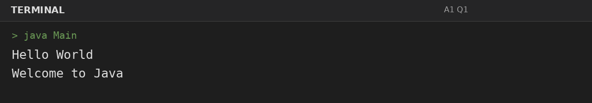
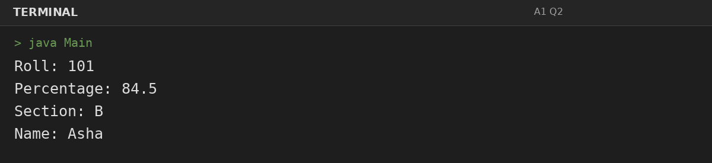
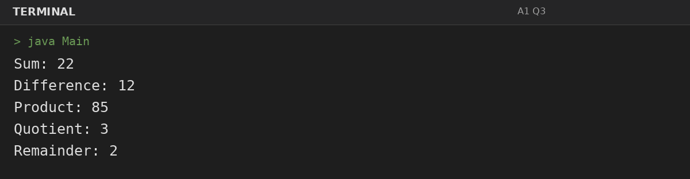
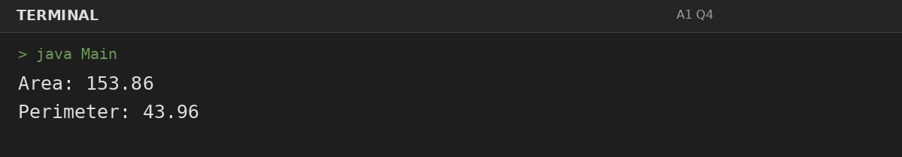

# Assignment 1: Hello World, Variables and Arithmetic

**Roll Number:** BCS2025477  
**Course:** BCS351 – Introduction to Programming Using Java Lab

## 1. Experiment Title
Hello World, Variables and Arithmetic

## 2. Aim
Print text, store values in variables and calculate with arithmetic operators.

## 3. Software / Tools Required
- Visual Studio Code (VS Code) – specified editor for writing and running the Java programs.
- Java Development Kit (JDK) – to compile and run Java programs.
- Terminal – to execute `javac Main.java` and `java Main`.

## 4. Theory
Java programs use the main method as the entry point. Variables store values, and arithmetic operators perform calculations.

## 5. Algorithm / Procedure
### Question 1: Print Hello World and Welcome to Java
1. Declare the required variables/constants, perform the requested operations, and print results in the specified order.
2. Execute the program and observe the console output.

### Question 2: Print variable values
1. Declare the required variables/constants, perform the requested operations, and print results in the specified order.
2. Execute the program and observe the console output.

### Question 3: Arithmetic operations
1. Declare the required variables/constants, perform the requested operations, and print results in the specified order.
2. Execute the program and observe the console output.

### Question 4: Circle area and perimeter
1. Declare the required variables/constants, perform the requested operations, and print results in the specified order.
2. Execute the program and observe the console output.

## 6. Input
### Question 1
No runtime input is required. The values are initialized in the program according to the assignment question.

### Question 2
No runtime input is required. The values are initialized in the program according to the assignment question.

### Question 3
No runtime input is required. The values are initialized in the program according to the assignment question.

### Question 4
No runtime input is required. The values are initialized in the program according to the assignment question.

## 7. Output
### Question 1: Print Hello World and Welcome to Java

### Question 2: Print variable values

### Question 3: Arithmetic operations

### Question 4: Circle area and perimeter

## 8. Result
All 4 program(s) for Assignment 1 were compiled and executed successfully with outputs matching the assignment's expected results.
