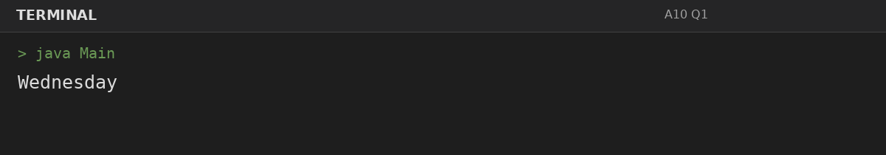
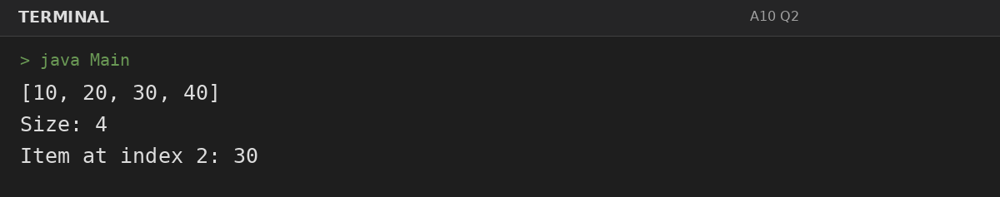
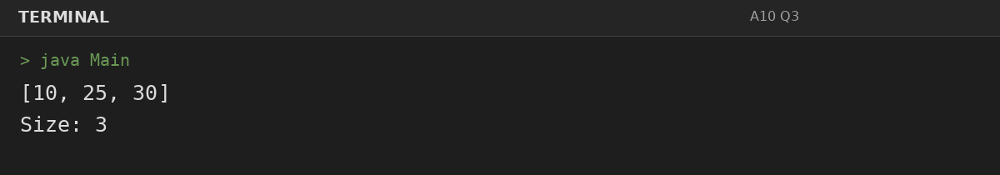

# Assignment 10: Switch and ArrayList

**Roll Number:** BCS2025477  
**Course:** BCS351 – Introduction to Programming Using Java Lab

## 1. Experiment Title
Switch and ArrayList

## 2. Aim
Use switch to choose a branch and ArrayList to store and modify numbers.

## 3. Software / Tools Required
- Visual Studio Code (VS Code) – specified editor for writing and running the Java programs.
- Java Development Kit (JDK) – to compile and run Java programs.
- Terminal – to execute `javac Main.java` and `java Main`.

## 4. Theory
A switch selects a matching case. ArrayList provides a resizable list with indexed access and modification.

## 5. Algorithm / Procedure
### Question 1: Print day name with switch
1. Use switch for the day selection or ArrayList methods to add, inspect, and modify the list.
2. Execute the program and observe the console output.

### Question 2: Create and inspect an ArrayList
1. Use switch for the day selection or ArrayList methods to add, inspect, and modify the list.
2. Execute the program and observe the console output.

### Question 3: Modify an ArrayList
1. Use switch for the day selection or ArrayList methods to add, inspect, and modify the list.
2. Execute the program and observe the console output.

## 6. Input
### Question 1
No runtime input is required. The values are initialized in the program according to the assignment question.

### Question 2
No runtime input is required. The values are initialized in the program according to the assignment question.

### Question 3
No runtime input is required. The values are initialized in the program according to the assignment question.

## 7. Output
### Question 1: Print day name with switch

### Question 2: Create and inspect an ArrayList

### Question 3: Modify an ArrayList

## 8. Result
All 3 program(s) for Assignment 10 were compiled and executed successfully with outputs matching the assignment's expected results.
