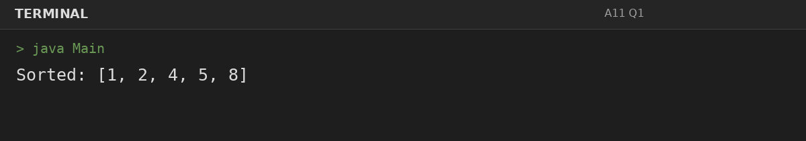
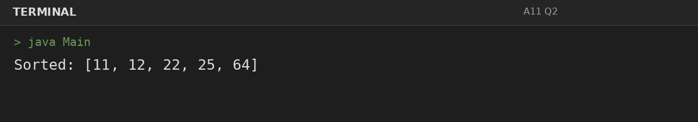
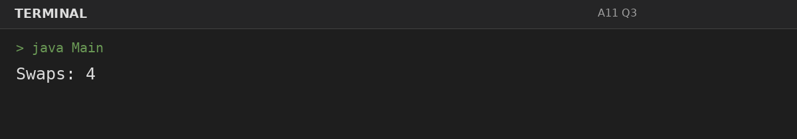

# Assignment 11: Bubble Sort and Selection Sort

**Roll Number:** BCS2025477  
**Course:** BCS351 – Introduction to Programming Using Java Lab

## 1. Experiment Title
Bubble Sort and Selection Sort

## 2. Aim
Sort arrays in increasing order and count swaps in bubble sort.

## 3. Software / Tools Required
- Visual Studio Code (VS Code) – specified editor for writing and running the Java programs.
- Java Development Kit (JDK) – to compile and run Java programs.
- Terminal – to execute `javac Main.java` and `java Main`.

## 4. Theory
Bubble sort swaps adjacent out-of-order values; selection sort selects the minimum remaining value.

## 5. Algorithm / Procedure
### Question 1: Sort using bubble sort
1. Apply the specified sorting algorithm by comparing values and swapping when needed; print the result or swap count.
2. Execute the program and observe the console output.

### Question 2: Sort using selection sort
1. Apply the specified sorting algorithm by comparing values and swapping when needed; print the result or swap count.
2. Execute the program and observe the console output.

### Question 3: Count bubble sort swaps
1. Apply the specified sorting algorithm by comparing values and swapping when needed; print the result or swap count.
2. Execute the program and observe the console output.

## 6. Input
### Question 1
No runtime input is required. The values are initialized in the program according to the assignment question.

### Question 2
No runtime input is required. The values are initialized in the program according to the assignment question.

### Question 3
No runtime input is required. The values are initialized in the program according to the assignment question.

## 7. Output
### Question 1: Sort using bubble sort

### Question 2: Sort using selection sort

### Question 3: Count bubble sort swaps

## 8. Result
All 3 program(s) for Assignment 11 were compiled and executed successfully with outputs matching the assignment's expected results.
