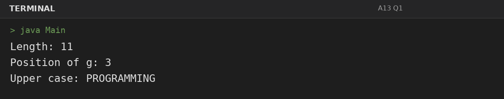
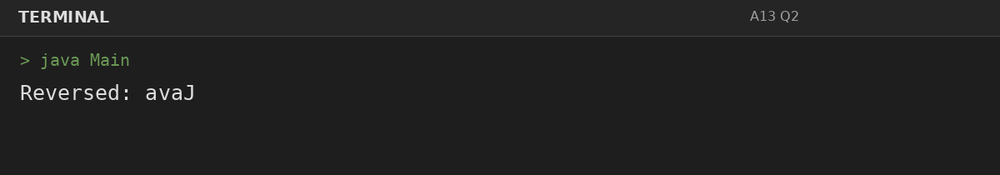
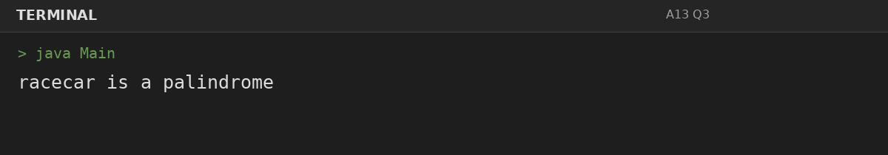
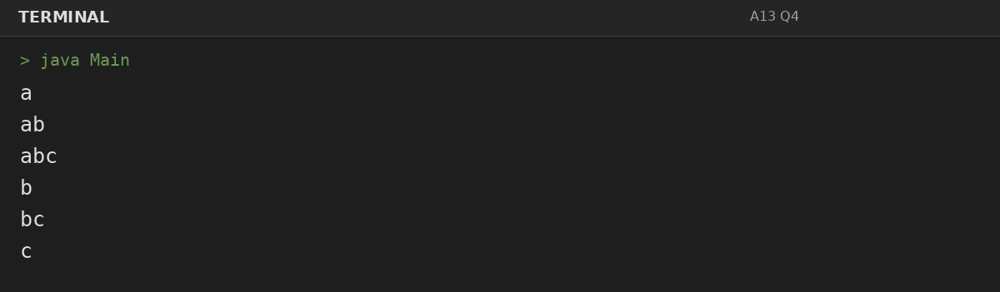

# Assignment 13: Strings: Methods and Palindromes

**Roll Number:** BCS2025477  
**Course:** BCS351 – Introduction to Programming Using Java Lab

## 1. Experiment Title
Strings: Methods and Palindromes

## 2. Aim
Use common String methods, reverse a word, check palindromes, and print substrings.

## 3. Software / Tools Required
- Visual Studio Code (VS Code) – specified editor for writing and running the Java programs.
- Java Development Kit (JDK) – to compile and run Java programs.
- Terminal – to execute `javac Main.java` and `java Main`.

## 4. Theory
String methods provide length, search, case conversion, character access, and substring extraction.

## 5. Algorithm / Procedure
### Question 1: String methods
1. Use String methods and loops to reverse/check the word or enumerate substrings in the required order.
2. Execute the program and observe the console output.

### Question 2: Reverse a word using charAt
1. Use String methods and loops to reverse/check the word or enumerate substrings in the required order.
2. Execute the program and observe the console output.

### Question 3: Check palindrome
1. Use String methods and loops to reverse/check the word or enumerate substrings in the required order.
2. Execute the program and observe the console output.

### Question 4: Print all substrings
1. Use String methods and loops to reverse/check the word or enumerate substrings in the required order.
2. Execute the program and observe the console output.

## 6. Input
### Question 1
No runtime input is required. The values are initialized in the program according to the assignment question.

### Question 2
No runtime input is required. The values are initialized in the program according to the assignment question.

### Question 3
No runtime input is required. The values are initialized in the program according to the assignment question.

### Question 4
No runtime input is required. The values are initialized in the program according to the assignment question.

## 7. Output
### Question 1: String methods

### Question 2: Reverse a word using charAt

### Question 3: Check palindrome

### Question 4: Print all substrings

## 8. Result
All 4 program(s) for Assignment 13 were compiled and executed successfully with outputs matching the assignment's expected results.
