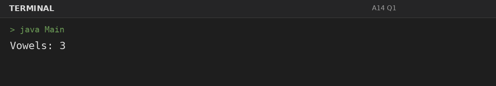
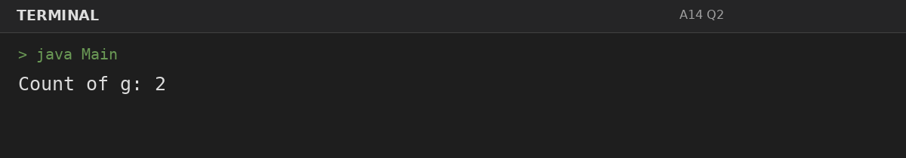
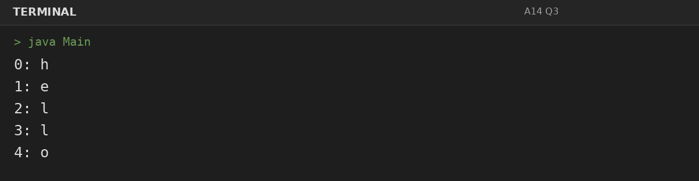

# Assignment 14: Characters: Counting and Positions

**Roll Number:** BCS2025477  
**Course:** BCS351 – Introduction to Programming Using Java Lab

## 1. Experiment Title
Characters: Counting and Positions

## 2. Aim
Use charAt to count vowels and a letter, and print each letter with its position.

## 3. Software / Tools Required
- Visual Studio Code (VS Code) – specified editor for writing and running the Java programs.
- Java Development Kit (JDK) – to compile and run Java programs.
- Terminal – to execute `javac Main.java` and `java Main`.

## 4. Theory
charAt accesses characters by zero-based index; loops can count character categories and occurrences.

## 5. Algorithm / Procedure
### Question 1: Count vowels
1. Traverse the string using charAt, count the requested characters, or print each character with its index.
2. Execute the program and observe the console output.

### Question 2: Count occurrences of g
1. Traverse the string using charAt, count the requested characters, or print each character with its index.
2. Execute the program and observe the console output.

### Question 3: Print letters and positions
1. Traverse the string using charAt, count the requested characters, or print each character with its index.
2. Execute the program and observe the console output.

## 6. Input
### Question 1
No runtime input is required. The values are initialized in the program according to the assignment question.

### Question 2
No runtime input is required. The values are initialized in the program according to the assignment question.

### Question 3
No runtime input is required. The values are initialized in the program according to the assignment question.

## 7. Output
### Question 1: Count vowels

### Question 2: Count occurrences of g

### Question 3: Print letters and positions

## 8. Result
All 3 program(s) for Assignment 14 were compiled and executed successfully with outputs matching the assignment's expected results.
