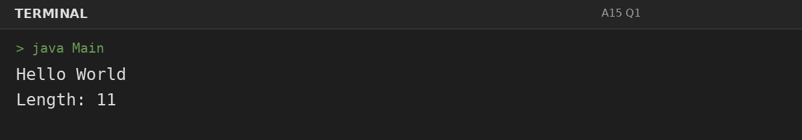
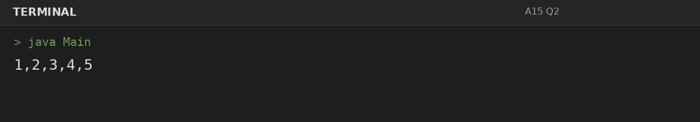
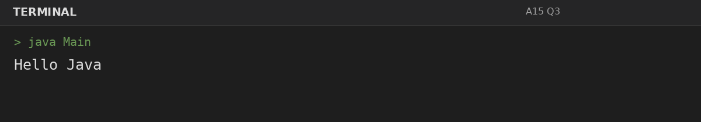

# Assignment 15: StringBuilder Methods

**Roll Number:** BCS2025477  
**Course:** BCS351 – Introduction to Programming Using Java Lab

## 1. Experiment Title
StringBuilder Methods

## 2. Aim
Build and change text with StringBuilder using append, insert, and deleteCharAt.

## 3. Software / Tools Required
- Visual Studio Code (VS Code) – specified editor for writing and running the Java programs.
- Java Development Kit (JDK) – to compile and run Java programs.
- Terminal – to execute `javac Main.java` and `java Main`.

## 4. Theory
StringBuilder efficiently builds and modifies mutable text using append, insert, and delete operations.

## 5. Algorithm / Procedure
### Question 1: Append text and print length
1. Create a StringBuilder, apply append/insert/deleteCharAt as required, and print the final text or length.
2. Execute the program and observe the console output.

### Question 2: Append numbers and remove final comma
1. Create a StringBuilder, apply append/insert/deleteCharAt as required, and print the final text or length.
2. Execute the program and observe the console output.

### Question 3: Insert greeting into StringBuilder
1. Create a StringBuilder, apply append/insert/deleteCharAt as required, and print the final text or length.
2. Execute the program and observe the console output.

## 6. Input
### Question 1
No runtime input is required. The values are initialized in the program according to the assignment question.

### Question 2
No runtime input is required. The values are initialized in the program according to the assignment question.

### Question 3
No runtime input is required. The values are initialized in the program according to the assignment question.

## 7. Output
### Question 1: Append text and print length

### Question 2: Append numbers and remove final comma

### Question 3: Insert greeting into StringBuilder

## 8. Result
All 3 program(s) for Assignment 15 were compiled and executed successfully with outputs matching the assignment's expected results.
