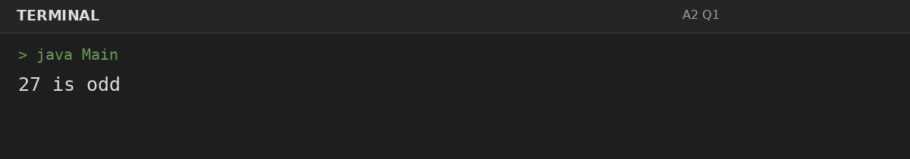
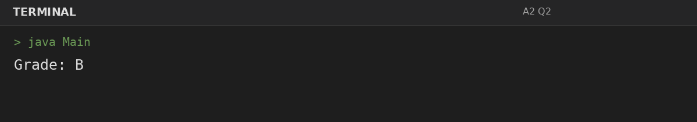
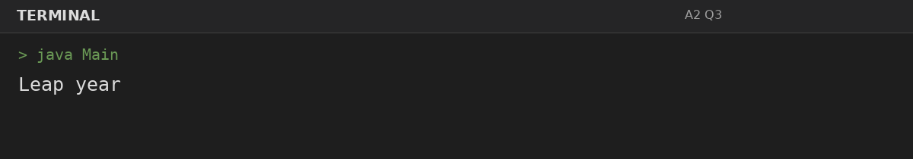
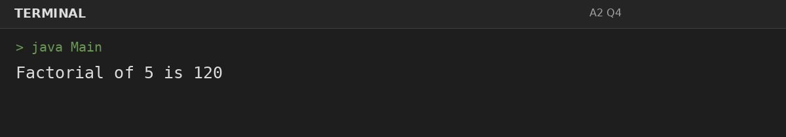

# Assignment 2: Decisions and Loops with Numbers

**Roll Number:** BCS2025477  
**Course:** BCS351 – Introduction to Programming Using Java Lab

## 1. Experiment Title
Decisions and Loops with Numbers

## 2. Aim
Use if, else-if and loops to make decisions and repeat steps with whole numbers.

## 3. Software / Tools Required
- Visual Studio Code (VS Code) – specified editor for writing and running the Java programs.
- Java Development Kit (JDK) – to compile and run Java programs.
- Terminal – to execute `javac Main.java` and `java Main`.

## 4. Theory
Conditional statements choose actions based on Boolean expressions, while loops repeat statements.

## 5. Algorithm / Procedure
### Question 1: Check even or odd
1. Initialize the specified value, evaluate the required condition or loop, and print the corresponding result.
2. Execute the program and observe the console output.

### Question 2: Assign a grade
1. Initialize the specified value, evaluate the required condition or loop, and print the corresponding result.
2. Execute the program and observe the console output.

### Question 3: Check leap year
1. Initialize the specified value, evaluate the required condition or loop, and print the corresponding result.
2. Execute the program and observe the console output.

### Question 4: Factorial using for loop
1. Initialize the specified value, evaluate the required condition or loop, and print the corresponding result.
2. Execute the program and observe the console output.

## 6. Input
### Question 1
No runtime input is required. The values are initialized in the program according to the assignment question.

### Question 2
No runtime input is required. The values are initialized in the program according to the assignment question.

### Question 3
No runtime input is required. The values are initialized in the program according to the assignment question.

### Question 4
No runtime input is required. The values are initialized in the program according to the assignment question.

## 7. Output
### Question 1: Check even or odd

### Question 2: Assign a grade

### Question 3: Check leap year

### Question 4: Factorial using for loop

## 8. Result
All 4 program(s) for Assignment 2 were compiled and executed successfully with outputs matching the assignment's expected results.
