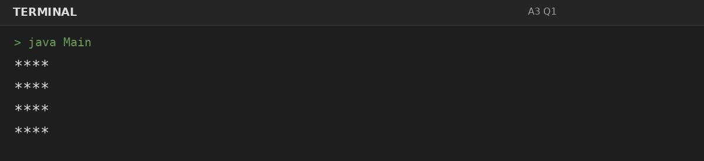
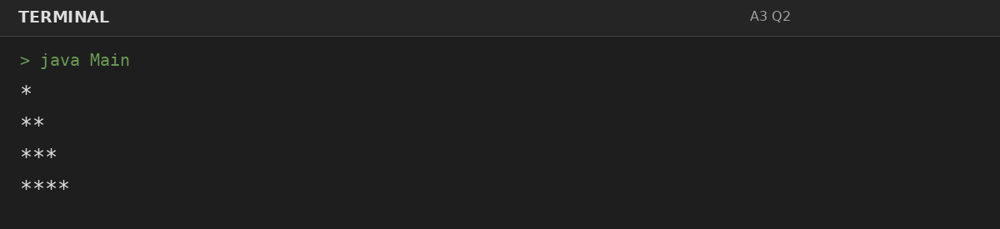
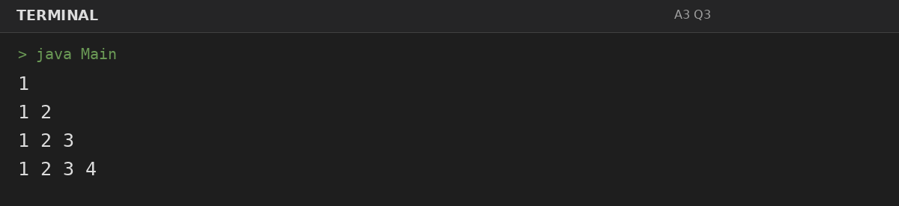
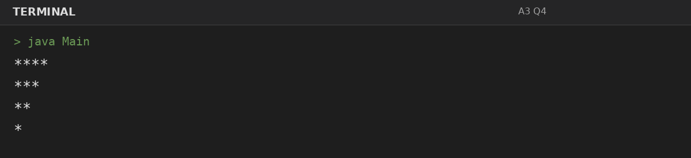

# Assignment 3: Star and Number Patterns

**Roll Number:** BCS2025477  
**Course:** BCS351 – Introduction to Programming Using Java Lab

## 1. Experiment Title
Star and Number Patterns

## 2. Aim
Use nested loops to print stars and numbers in rows.

## 3. Software / Tools Required
- Visual Studio Code (VS Code) – specified editor for writing and running the Java programs.
- Java Development Kit (JDK) – to compile and run Java programs.
- Terminal – to execute `javac Main.java` and `java Main`.

## 4. Theory
Nested loops place one loop inside another to build row-and-column patterns.

## 5. Algorithm / Procedure
### Question 1: Square of stars
1. Use nested loops to control the number of rows and the number of symbols or numbers in each row.
2. Execute the program and observe the console output.

### Question 2: Right triangle of stars
1. Use nested loops to control the number of rows and the number of symbols or numbers in each row.
2. Execute the program and observe the console output.

### Question 3: Number triangle
1. Use nested loops to control the number of rows and the number of symbols or numbers in each row.
2. Execute the program and observe the console output.

### Question 4: Upside-down triangle of stars
1. Use nested loops to control the number of rows and the number of symbols or numbers in each row.
2. Execute the program and observe the console output.

## 6. Input
### Question 1
No runtime input is required. The values are initialized in the program according to the assignment question.

### Question 2
No runtime input is required. The values are initialized in the program according to the assignment question.

### Question 3
No runtime input is required. The values are initialized in the program according to the assignment question.

### Question 4
No runtime input is required. The values are initialized in the program according to the assignment question.

## 7. Output
### Question 1: Square of stars

### Question 2: Right triangle of stars

### Question 3: Number triangle

### Question 4: Upside-down triangle of stars

## 8. Result
All 4 program(s) for Assignment 3 were compiled and executed successfully with outputs matching the assignment's expected results.
