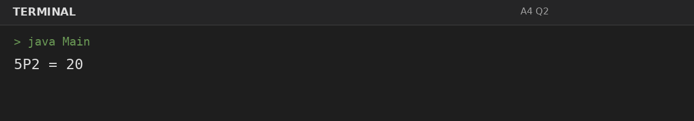
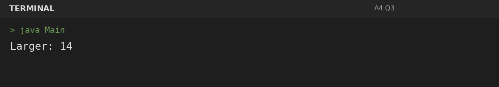

# Assignment 4: Writing Functions

**Roll Number:** BCS2025477  
**Course:** BCS351 – Introduction to Programming Using Java Lab

## 1. Experiment Title
Writing Functions

## 2. Aim
Write functions with parameters and return values, and call them from main.

## 3. Software / Tools Required
- Visual Studio Code (VS Code) – specified editor for writing and running the Java programs.
- Java Development Kit (JDK) – to compile and run Java programs.
- Terminal – to execute `javac Main.java` and `java Main`.

## 4. Theory
Methods allow reusable logic to receive parameters and return calculated values.

## 5. Algorithm / Procedure
### Question 1: Calculate combinations nCr
1. Define the required method, calculate and return the result, then call it from main and print it.
2. Execute the program and observe the console output.

### Question 2: Calculate permutations nPr
1. Define the required method, calculate and return the result, then call it from main and print it.
2. Execute the program and observe the console output.

### Question 3: Find the larger value
1. Define the required method, calculate and return the result, then call it from main and print it.
2. Execute the program and observe the console output.

## 6. Input
### Question 1
No runtime input is required. The values are initialized in the program according to the assignment question.

### Question 2
No runtime input is required. The values are initialized in the program according to the assignment question.

### Question 3
No runtime input is required. The values are initialized in the program according to the assignment question.

## 7. Output
### Question 1: Calculate combinations nCr

### Question 2: Calculate permutations nPr

### Question 3: Find the larger value

## 8. Result
All 3 program(s) for Assignment 4 were compiled and executed successfully with outputs matching the assignment's expected results.
