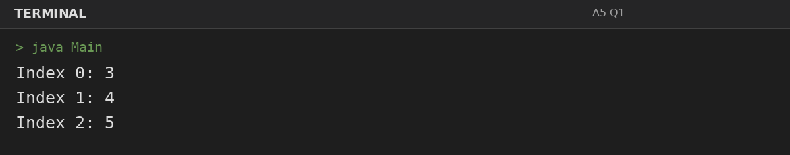
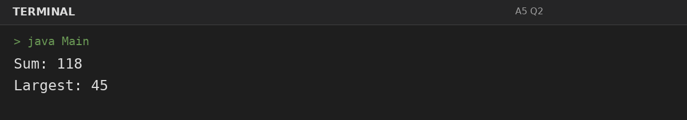
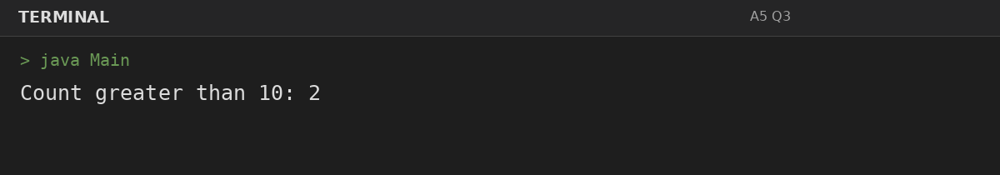

# Assignment 5: Arrays: Traversal and Counting

**Roll Number:** BCS2025477  
**Course:** BCS351 – Introduction to Programming Using Java Lab

## 1. Experiment Title
Arrays: Traversal and Counting

## 2. Aim
Create arrays, visit every element with loops, and add or count values.

## 3. Software / Tools Required
- Visual Studio Code (VS Code) – specified editor for writing and running the Java programs.
- Java Development Kit (JDK) – to compile and run Java programs.
- Terminal – to execute `javac Main.java` and `java Main`.

## 4. Theory
Arrays store multiple values of one type; loops traverse elements to calculate sums and counts.

## 5. Algorithm / Procedure
### Question 1: Traverse array with indices
1. Initialize the array, traverse it with a loop, update the required accumulator/count, and print the result.
2. Execute the program and observe the console output.

### Question 2: Find sum and largest value
1. Initialize the array, traverse it with a loop, update the required accumulator/count, and print the result.
2. Execute the program and observe the console output.

### Question 3: Count values greater than 10
1. Initialize the array, traverse it with a loop, update the required accumulator/count, and print the result.
2. Execute the program and observe the console output.

## 6. Input
### Question 1
No runtime input is required. The values are initialized in the program according to the assignment question.

### Question 2
No runtime input is required. The values are initialized in the program according to the assignment question.

### Question 3
No runtime input is required. The values are initialized in the program according to the assignment question.

## 7. Output
### Question 1: Traverse array with indices

### Question 2: Find sum and largest value

### Question 3: Count values greater than 10

## 8. Result
All 3 program(s) for Assignment 5 were compiled and executed successfully with outputs matching the assignment's expected results.
