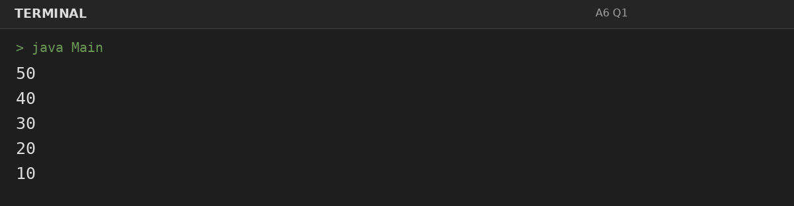
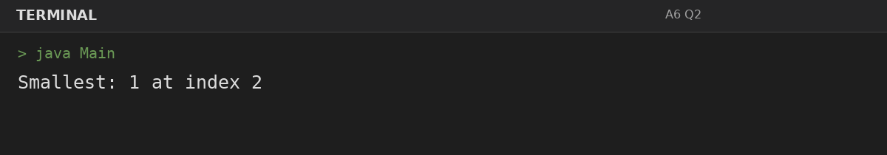
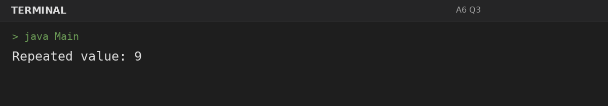

# Assignment 6: Arrays: Reverse and Duplicates

**Roll Number:** BCS2025477  
**Course:** BCS351 – Introduction to Programming Using Java Lab

## 1. Experiment Title
Arrays: Reverse and Duplicates

## 2. Aim
Print arrays in reverse, find the smallest value, and check for repeated values.

## 3. Software / Tools Required
- Visual Studio Code (VS Code) – specified editor for writing and running the Java programs.
- Java Development Kit (JDK) – to compile and run Java programs.
- Terminal – to execute `javac Main.java` and `java Main`.

## 4. Theory
Array indices begin at zero. Reverse traversal and nested loops can locate minimums and repeated values.

## 5. Algorithm / Procedure
### Question 1: Print array in reverse
1. Initialize the array, traverse in reverse or compare elements using loops, and print the required finding.
2. Execute the program and observe the console output.

### Question 2: Find smallest value and index
1. Initialize the array, traverse in reverse or compare elements using loops, and print the required finding.
2. Execute the program and observe the console output.

### Question 3: Find a repeated value
1. Initialize the array, traverse in reverse or compare elements using loops, and print the required finding.
2. Execute the program and observe the console output.

## 6. Input
### Question 1
No runtime input is required. The values are initialized in the program according to the assignment question.

### Question 2
No runtime input is required. The values are initialized in the program according to the assignment question.

### Question 3
No runtime input is required. The values are initialized in the program according to the assignment question.

## 7. Output
### Question 1: Print array in reverse

### Question 2: Find smallest value and index

### Question 3: Find a repeated value

## 8. Result
All 3 program(s) for Assignment 6 were compiled and executed successfully with outputs matching the assignment's expected results.
