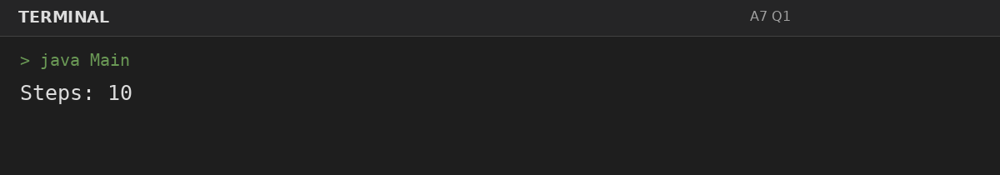
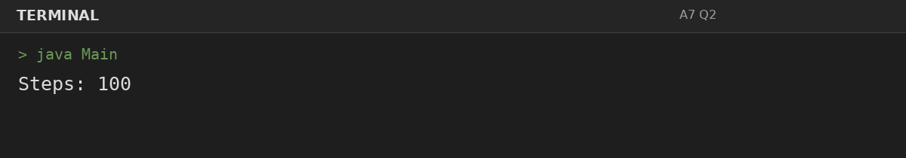
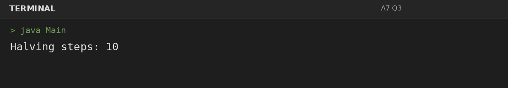

# Assignment 7: Counting Steps and Complexity

**Roll Number:** BCS2025477  
**Course:** BCS351 – Introduction to Programming Using Java Lab

## 1. Experiment Title
Counting Steps and Complexity

## 2. Aim
Count the steps a program takes and state time complexity in comments.

## 3. Software / Tools Required
- Visual Studio Code (VS Code) – specified editor for writing and running the Java programs.
- Java Development Kit (JDK) – to compile and run Java programs.
- Terminal – to execute `javac Main.java` and `java Main`.

## 4. Theory
Step counts describe repeated operations; Big-O notation expresses how work grows with input size.

## 5. Algorithm / Procedure
### Question 1: Count steps in one loop
1. Initialize a step counter, increment it for each counted operation, and print the final count. Complexity is noted in code.
2. Execute the program and observe the console output.

### Question 2: Count steps in nested loops
1. Initialize a step counter, increment it for each counted operation, and print the final count. Complexity is noted in code.
2. Execute the program and observe the console output.

### Question 3: Count repeated halving steps
1. Initialize a step counter, increment it for each counted operation, and print the final count. Complexity is noted in code.
2. Execute the program and observe the console output.

## 6. Input
### Question 1
No runtime input is required. The values are initialized in the program according to the assignment question.

### Question 2
No runtime input is required. The values are initialized in the program according to the assignment question.

### Question 3
No runtime input is required. The values are initialized in the program according to the assignment question.

## 7. Output
### Question 1: Count steps in one loop

### Question 2: Count steps in nested loops

### Question 3: Count repeated halving steps

## 8. Result
All 3 program(s) for Assignment 7 were compiled and executed successfully with outputs matching the assignment's expected results.
