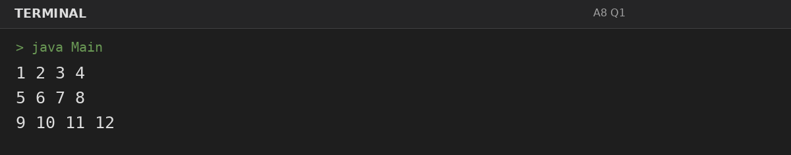
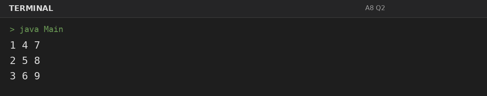
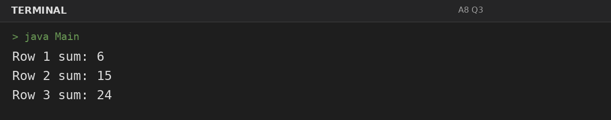

# Assignment 8: Matrices: Transpose and Row Sums

**Roll Number:** BCS2025477  
**Course:** BCS351 – Introduction to Programming Using Java Lab

## 1. Experiment Title
Matrices: Transpose and Row Sums

## 2. Aim
Create two-dimensional arrays, visit them row by row, and build a transpose.

## 3. Software / Tools Required
- Visual Studio Code (VS Code) – specified editor for writing and running the Java programs.
- Java Development Kit (JDK) – to compile and run Java programs.
- Terminal – to execute `javac Main.java` and `java Main`.

## 4. Theory
A two-dimensional array stores values in rows and columns. A transpose exchanges row and column positions.

## 5. Algorithm / Procedure
### Question 1: Fill and print a 3 by 4 matrix
1. Create the matrix, use nested loops to populate or traverse it, and print each row or computed row result.
2. Execute the program and observe the console output.

### Question 2: Transpose a matrix
1. Create the matrix, use nested loops to populate or traverse it, and print each row or computed row result.
2. Execute the program and observe the console output.

### Question 3: Calculate each row sum
1. Create the matrix, use nested loops to populate or traverse it, and print each row or computed row result.
2. Execute the program and observe the console output.

## 6. Input
### Question 1
No runtime input is required. The values are initialized in the program according to the assignment question.

### Question 2
No runtime input is required. The values are initialized in the program according to the assignment question.

### Question 3
No runtime input is required. The values are initialized in the program according to the assignment question.

## 7. Output
### Question 1: Fill and print a 3 by 4 matrix

### Question 2: Transpose a matrix

### Question 3: Calculate each row sum

## 8. Result
All 3 program(s) for Assignment 8 were compiled and executed successfully with outputs matching the assignment's expected results.
