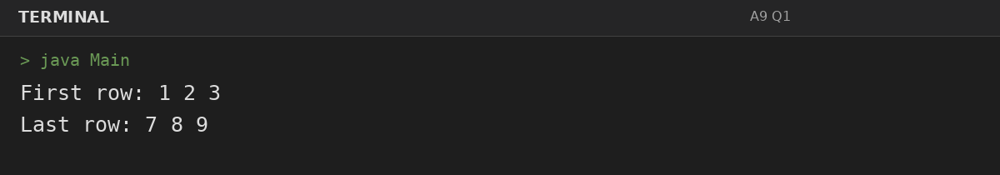
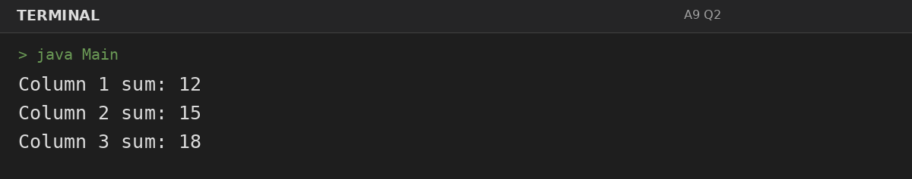
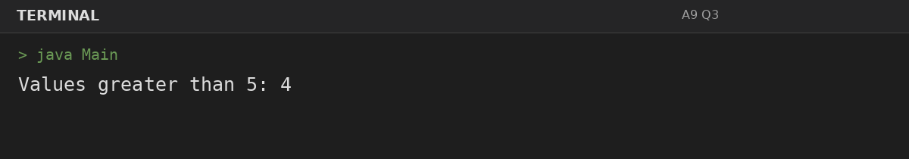

# Assignment 9: Matrices: Rows and Columns

**Roll Number:** BCS2025477  
**Course:** BCS351 – Introduction to Programming Using Java Lab

## 1. Experiment Title
Matrices: Rows and Columns

## 2. Aim
Use nested loops to print, add, and count matrix values by rows and columns.

## 3. Software / Tools Required
- Visual Studio Code (VS Code) – specified editor for writing and running the Java programs.
- Java Development Kit (JDK) – to compile and run Java programs.
- Terminal – to execute `javac Main.java` and `java Main`.

## 4. Theory
Nested loops can process matrix rows, columns, and values meeting a condition.

## 5. Algorithm / Procedure
### Question 1: Print first and last row
1. Traverse the specified matrix by row or column, accumulate/count the required values, and print the result.
2. Execute the program and observe the console output.

### Question 2: Calculate each column sum
1. Traverse the specified matrix by row or column, accumulate/count the required values, and print the result.
2. Execute the program and observe the console output.

### Question 3: Count values greater than 5
1. Traverse the specified matrix by row or column, accumulate/count the required values, and print the result.
2. Execute the program and observe the console output.

## 6. Input
### Question 1
No runtime input is required. The values are initialized in the program according to the assignment question.

### Question 2
No runtime input is required. The values are initialized in the program according to the assignment question.

### Question 3
No runtime input is required. The values are initialized in the program according to the assignment question.

## 7. Output
### Question 1: Print first and last row

### Question 2: Calculate each column sum

### Question 3: Count values greater than 5

## 8. Result
All 3 program(s) for Assignment 9 were compiled and executed successfully with outputs matching the assignment's expected results.
